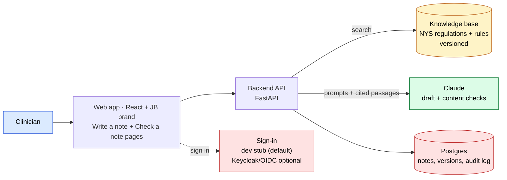
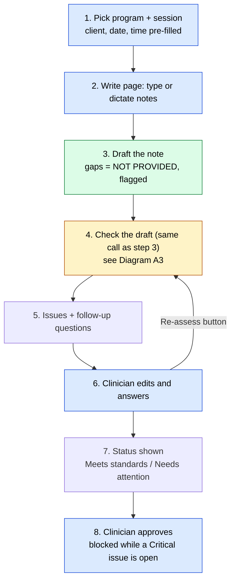
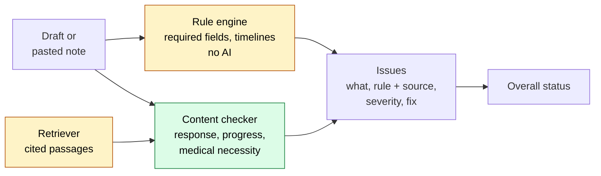
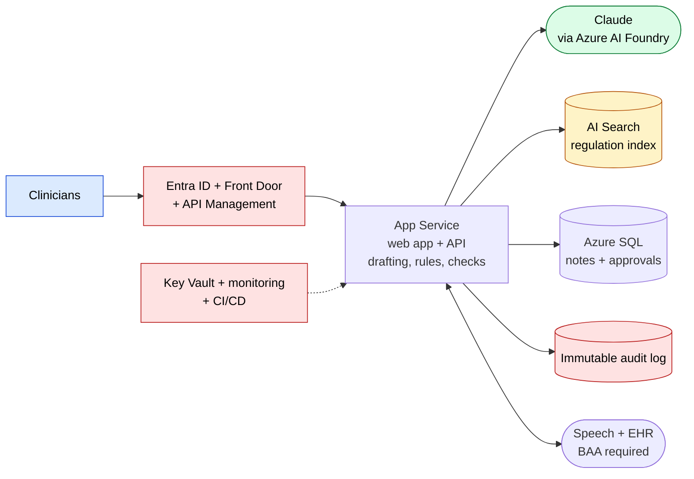

# Architecture & Implementation Plan — Clinical Documentation Assistant

**Decisions:**
- Python (FastAPI) + React (Vite).
- The prototype runs the open-source versions of the production building blocks:
  - **`AUTH_PROVIDER=dev`** (a fixed offline demo user) for sign-in by default; no container runtime required. The real `oidc` adapter against **Keycloak** is an optional stretch path, not needed to run or demo the prototype.
  - **Postgres + pgvector**, installed natively (or any Postgres the dev already has, or a managed/cloud instance), for data and hybrid search.
  - **Docling** for document parsing.
  - **bge** embeddings, run locally.
- **Every external capability sits behind a provider wrapper.** Switching to Azure (Entra ID, AI Search, Blob, Key Vault, AI Speech) or to another vendor is a change to `.env` plus one new adapter file. No business-logic changes. See §2.7.

## 0. Architecture diagrams

The diagrams are split into small pictures. Each one answers one question and has 10 boxes or fewer. Detail lives in the tables in §2, not in the pictures.

| Diagram | Question it answers |
|---|---|
| A1 | What are the main parts of the prototype? |
| A2 | What does the clinician do, step by step? |
| A3 | How is a draft checked? |
| B | What would the production version on Azure look like? |

Colors:
- Blue: the clinician, who is in control.
- Green: AI (Claude).
- Amber: rules, regulations and versioned sources.
- Red: security and compliance.

### Diagram A1: Prototype, main parts



### Diagram A2: Prototype, one note from start to finish



Diagram A2 shows the **Write a note** page. Steps 3 and 4 are one orchestrated `POST /draft` call from the frontend's perspective, not two separate frontend-triggered steps — the backend runs drafting, the rule engine, the content checker and follow-up generation together and returns it all at once. The same is true of the step 6 → step 4 "Re-assess" loop: one `POST /assess` call carries the clinician's edited note text and follow-up answers together, and the backend saves and re-checks both in that single request. Notes written elsewhere go through the separate **Check a note** page: the clinician pastes the note, step 3 (drafting) is skipped, and it goes straight to step 4. From step 5 onward both pages use the same review screen (editor, issues panel, status, approve).

### Diagram A3: Prototype, how a draft is checked



### Diagram B: Target production (Azure)



Production notes, kept out of the picture:
- Rule sets and prompts live in a Git repo, and compliance staff review changes.
- Source documents sit in versioned Blob storage and feed the AI Search index.
- GitHub Actions + Bicep deploy them, with an evaluation gate on the synthetic pass/fail set.

### Requirement coverage

| Brief requirement | Prototype (A1–A3, plus §2) | Diagram B |
|---|---|---|
| Program frameworks, every rule cites source | Rule sets + Regulation library | Rule authoring → Git repo; Ingest → AI Search |
| Program chosen by clinician or role | `dev` stub program roles (Keycloak program roles if the oidc stretch is picked up) → Program selector | Entra ID role |
| 5 Dictate / type / paste | Write page (type, dictate) + Web Speech; Check page (paste) | Web app + Azure AI Speech |
| 6 Draft in program format (SOAP) | Drafter | Drafter |
| 7 Pre-fill session details | Session context ← Synthetic records | Session context ← EHR |
| 8 Link to treatment plan goals | Drafter | Drafter |
| 9 Never invent, blanks flagged | No-invention guard | No-invention guard |
| 10 Program + Medicaid / NYS checks | Rule engine + Content checker + common rules | same |
| 11–12 Issue detail + severity | Issues panel | Web app |
| 13 Assess pasted note | Check a note page → Rule engine + Content checker | Web app → Orchestrator |
| 14 Follow-up questions | Follow-up generator → answers → Drafter | same |
| 15 Clinician approves everything | Approve & finalize | Clinician-approved note → SQL |
| 16 Overall status | Status calculator | Web app |
| 17 Web app layout | Web app: Write and Check pages sharing one review screen (§2.5) | Web app |
| 18 Speech-to-text | Web Speech API | Azure AI Speech (BAA) |
| 19 Retrieval knowledge base | Content pipeline → pgvector hybrid → Retriever | Azure AI Search |
| 20 Deterministic + Claude checks | Rule engine + Content checker | same |
| 21 Fixed output schema | Claude client wrapper | Claude gateway (schema validation) |
| 22 Versioned prompts, rules, docs | git + manifest + audit records versions | Git repo + versioned Blob + CI |
| 23 Synthetic pass/fail demo | Demo notes + evaluation script | CI evaluation gate |
| 24 HIPAA, BAA, EHR, audit | `dev`-stub RBAC (Keycloak RBAC if oidc stretch is picked up) + hash-chained audit log (stand-ins) | BAAs, EHR, immutable audit log, Key Vault, RBAC |
| Switch providers later | Provider registry (§2.7) | Same interfaces, Azure adapters |
| No secrets in code | .env | Key Vault |

## 1. System architecture

```
┌──────────────────────── React (Vite) + JB brand ────────────────────────┐
│ ProgramSelector │ /write: SessionPicker + DictationBox (🎤 Web Speech)   │
│ /check: PasteBox │ shared review: NoteEditor │ IssuesPanel │ FollowUpQs    │
│ StatusBanner │ Approve                                                   │
└───────────────▲──────────────────────────────────────────────────────────┘
                │ REST/JSON
┌───────────────┴──────────────── FastAPI backend ─────────────────────────┐
│ /programs  /sessions  /draft  /assess  /followups  /notes/{id}/approve   │
│                                                                          │
│  DraftService ──┐        AssessService ──────────────┐                   │
│                 ▼                                    ▼                   │
│        Retriever (KB)   RuleEngine (deterministic)  ContentChecker(LLM) │
│                 │              │                     │                   │
│                 ▼              ▼                     ▼                   │
│        LLM Client wrapper (Claude; provider via env) → structured output│
│                                                                          │
│  AuditLog (every draft/edit/approval)   TimeUtil (12h ET formatting)     │
│  Provider registry: llm · auth · parser · embeddings · search · blob ·   │
│                     speech · secrets · audit   (all chosen in .env)      │
└──────────────────────────────────────────────────────────────────────────┘
        │                 │                    │                  │
  knowledge-base/    rules/<program>.yaml   synthetic-data/   Postgres + pgvector      Sign-in: dev stub
  (NYS docs) → Docling → bge → index        (clients, sessions,  (notes, versions,     (default); Keycloak
                      (versioned)            plans, notes)        audit, KB vectors)    (OIDC) optional
```

## 2. Components

### 2.1 Knowledge base and content pipeline (RAG, req 19, 22)
The pipeline runs offline with `python -m backend.kb.ingest`. It is re-run whenever a source document or the manifest changes.

| Step | Prototype (open source) | Wrapper | Output |
|---|---|---|---|
| 1. Collect | NYS PDFs/HTML in `knowledge-base/sources/<program>/` plus `manifest.yaml` (id, title, url, date, version, sha256) | `BlobStore` (local folder; Azure Blob later) | Versioned source files |
| 2. Parse | **Docling** keeps headings, section numbers, tables and page numbers. **pypdf** is the fallback. | `DocumentParser` | Sections with `doc_id`, `section`, `page` |
| 3. Chunk | Split by section, about 500 tokens with overlap. Never split across sections. | plain code | Chunks with `program`, `doc_version` |
| 4. Embed | **sentence-transformers `BAAI/bge-small-en-v1.5`**. Runs locally on CPU, needs no key, and no text leaves the machine. | `Embedder` | 384-dimension vectors |
| 5. Index | **Postgres + pgvector** (vector) and **Postgres full-text search** (keyword) in one table | `SearchProvider` | Hybrid index |
| 6. Retrieve | Keyword and vector results merged by reciprocal-rank fusion and filtered to `program ∈ {selected, common}`. Optional **bge-reranker-base** (stretch, skip for the prototype). | `SearchProvider.search()` | Passages with citations |

- **Why hybrid:**
  - Regulations use exact terms such as "14 NYCRR 599" and "medical necessity", which keyword search finds best.
  - Clinicians phrase things loosely, which vector search finds best.
- **Versioning (req 22):**
  - The manifest hash and the embedding model name are stored with every index build.
  - Every draft and assessment records which index build it used.
- **Retrieval check:** `scripts/eval_retrieval.py` runs about 20 hand-written question → expected `doc_id#section` pairs and reports hit@5.
- **Grounding:** retrieved passages go into the prompt, and Claude must cite their `doc_id` and section in each issue.

### 2.2 Program frameworks and rule sets (requirements on frameworks and 20, 22)
- `rules/<program>.yaml` exists for each of the five programs. Each file has a `version` and lists `note_types` (progress note, treatment plan update) with sections and format (SOAP or narrative), and `rules`.
- Rule shape:
  ```yaml
  - id: ACT-A-001
    element: "Client response to intervention"
    type: llm_content | required_field | timeline | signature | pattern
    params: { field: service_date }          # or { max_days_after_service: 2 }
    severity: Critical
    requirement: "Progress note must document client response…"
    source: { doc_id: "omh-act-guidelines-2023", section: "IV.B", url: "…" }
  ```
- The **RuleEngine** runs deterministic types in plain Python: required fields present, note signed within N days, plan review due by date, duration and modality present, goal linkage present. **ContentChecker** sends `llm_content` rules to Claude in a batch, together with the retrieved source passages.
- A shared `rules/_common_medicaid_nys.yaml` holds Medicaid and NYS-wide standards (req 10) and is merged into each program's rules.

### 2.3 LLM layer (reqs 6, 9, 14, 21, 22)
- `backend/providers/llm/base.py` defines one function, `complete_structured(prompt_id, vars, schema)`. The provider is chosen by `LLM_PROVIDER=anthropic|azure_foundry` plus the model and key in `.env`. Nothing is hard-coded.
- Pydantic schemas are enforced through Claude tool use or structured output:
  - `Issue{issue, element, rule_id, rule, source{doc_id,section,url}, severity, suggestion}` (req 21)
  - `Draft{sections[{name, text, source_spans[], status: filled|blank_flagged}], goal_links[{goal_id, intervention, progress}]}`
  - `FollowUp{question, element, rule_id}`
- **Guarding against invented content (req 9):**
  - The prompt says to use only the clinician's input and the record, and to leave anything missing as `[NOT PROVIDED]`.
  - Each filled section must cite `source_spans`, which point into the input text.
  - A post-check flags any section whose spans don't appear in the input.
- Prompts live in `prompts/*.md` with a version in their front matter. The prompt version, rule version and KB manifest hash are stored with every draft and every assessment (req 22).

### 2.4 Services and API
| Endpoint | Purpose | Req |
|---|---|---|
| `GET /programs` | List programs and their frameworks | frameworks |
| `GET /sessions?program=` | Synthetic sessions with client, date/time, service type, modality and treatment plan goals | 7 |
| `POST /draft` | Session + clinician text → **one orchestrated call**: drafts the note (pre-filled, program format, linked to goals, blanks flagged), then internally runs the rule engine + content checker and generates the first round of follow-up questions. Returns `{note_id, draft_text, issues[], followup_questions[]}` in one response. This is the **only** call the Write page's initial "Draft" action makes — the frontend never calls `/assess` separately after it. | 5–9, 10–13, 14 |
| `POST /assess` | Draft or pasted note → deterministic and LLM issues, followed by overall status. On the Write page this is also the **single call behind the Re-assess button** for every edit/follow-up loop after the initial draft: it takes the clinician's current `NoteEditor` text plus the current follow-up answers in one request, persists both as a new version (note edit and follow-up answers both land in the audit log), then internally re-runs the draft-merge step (the LLM decides how to incorporate the answers, treating the submitted `NoteEditor` text as authoritative — never silently discarded or regenerated from the original session input), the rule engine, the content checker, and follow-up generation. Returns `{draft_text, issues[], followup_questions[], status}` together; the UI updates `NoteEditor` only if `draft_text` differs from what was submitted. On the Check page it is called directly with no prior `/draft` call, same response shape minus the draft-merge step (nothing to merge against). | 10–13, 14, 16 |
| `PUT /notes/{id}` | Save clinician edits as a new version | 15 |
| `POST /notes/{id}/approve` | Approve. Re-assesses server-side before approving and returns 409 while any Critical issue is open — intentional, since nothing auto-reassesses on keystroke and the client's last-known status can go stale if the clinician edits after their last Re-assess. The clinician sees the status and confirms. | 15–16 |

`/followups` is not a separate route the frontend calls — follow-up generation is an internal step inside `/draft` and `/assess`, described above.

- Overall status rule: any open Critical issue → **Needs attention**. No Critical issues but some Warnings → **Meets standards with warnings**. Otherwise → **Meets standards**.
- **Postgres** (SQLModel; a native local install or managed instance with the `pgvector` extension enabled) stores `notes`, `note_versions`, the KB chunks, and an append-only `audit_log` with actor, action, timestamp and versions.
  - Each audit row stores a hash of the previous row, so tampering is visible.
  - This is a stand-in for the immutable production audit log (req 24).
  - The `actor` value comes from the signed-in user's token, not from the request body.
- Every endpoint except `/health` requires a valid token. The program in the request must be one of the user's program roles (see §2.8). All timestamps are stored in UTC and shown as `M/D/YYYY h:mm AM/PM ET` using `zoneinfo("America/New_York")`.
- **Postgres is installed natively** (or via any Postgres the developer already has, or a managed/cloud instance) with the `pgvector` extension enabled; no container runtime is required to run the prototype.

### 2.5 Frontend (reqs 17, 18)
- **Two pages** under one app shell (header, logo, program selector, "SYNTHETIC DATA – DEMO ONLY" badge). They are separate pages, not a mode toggle, so a clinician never has to wonder which mode they are in.

  | | **Write a note** (`/write`) | **Check a note** (`/check`) |
  |---|---|---|
  | Purpose | Draft a note from session notes | Assess a note written elsewhere |
  | Session | Session picker, required; pre-fills the draft | Optional date-of-service field |
  | Note type | Set by the session or program | Selector: progress note or treatment plan update |
  | Input | Text area with a mic button (Web Speech API, text fallback) | Large paste area, no mic |
  | Backend | One `POST /draft` call (orchestrates draft + checks + follow-ups server-side) | `POST /assess` only |
  | Follow-up answers | Typed into the answer box; no separate submit — carried along with the next **Re-assess** click, which sends note text + answers together | Display-only question, no answer box; clinician edits the note directly, then re-assesses |

- **Shared review screen**, used by both pages and built once: note editor in which blank or flagged sections are highlighted → issues panel grouped by severity, each issue showing requirement, source link and fix → follow-up questions → status banner → **Re-assess** and **Approve** buttons, plus a version drawer. Each page is a thin wrapper that collects input differently, then hands off to this screen. A shared `useNoteReview` hook holds the note, issues, status and approval state.
- The input components are `DictationBox` (Write page) and `PasteBox` (Check page). Each page keeps its own text state.
- **Draft button** (Write page only, first action): calls `POST /draft` once. Populates `NoteEditor`, `IssuesPanel`, and the follow-up questions from the single response — there is no follow-up frontend call to `/assess`.
- **Re-assess button:** the only other network-triggering action before Approve, and it is backed by a single `POST /assess` call, not a client-side chain of separate save/assess/follow-up calls. It sends the clinician's current `NoteEditor` text plus current follow-up answers in one request; the backend persists both as a new version and returns updated draft/issues/follow-ups. There is no separate "Save" button — nothing is re-checked automatically on every edit or keystroke, so the clinician edits (and optionally answers follow-ups), then clicks Re-assess to save and re-check together.
- **Approve button:** doubles as the save/finalize action (`POST /notes/{id}/approve`). Disabled on the client while any Critical issue is open; the 409 from the server is the real gate. The server re-assessing on approve is intentional, not redundant: it catches edits made after the clinician's last Re-assess click, so the approved text and the assessment that cleared it are always the same version. (Considered and rejected tracking client-side "dirty since last Re-assess" state to pre-emptively disable Approve — the server-side check is sufficient.)
- **Check page follow-up questions are display-only.** No answer input box. The clinician reads the question, edits the pasted note in `NoteEditor` directly to address it, then clicks Re-assess. (Write page follow-ups keep their answer box, folded into the Re-assess call as described above.)
- `/draft` and `/assess` share a common response shape: `draft_text`, `issues[]`, `followup_questions[]`, plus `note_id`/`status` as applicable (see §2.4).
- The JB brand skill supplies the logo, colors and fonts as CSS variables. A permanent "SYNTHETIC DATA – DEMO ONLY" badge is shown.

### 2.6 Synthetic data (req 23)
`synthetic-data/<program>/` contains:
- `clients.json`: fictional clients with treatment plan goals.
- `sessions.json`.
- `notes/pass_*.md` and `notes/fail_*.md`: at least one of each per program. Each failing note is designed to break specific rule ids, which are listed in an `expected.json`.

### 2.7 Provider adapters (switch providers by configuration)
Business code (services, rule engine, API) depends only on **interfaces** in `backend/providers/<capability>/base.py`.
- `backend/providers/registry.py` reads `.env` once at startup and builds the chosen adapter for each capability.
- Adding a provider means writing one adapter file and registering one line. Nothing else changes.

| Capability | Interface (methods) | Prototype adapter (open source) | Production / alternative adapters | Setting |
|---|---|---|---|---|
| Claude | `LLMProvider.complete_structured(prompt_id, vars, schema)` | `anthropic` (direct API) | `azure_foundry` | `LLM_PROVIDER` |
| Identity | `AuthProvider.verify(token) → Principal{user_id, name, roles, programs}` | `dev` stub (default, offline, fixed demo user) | `oidc` → **Keycloak** (optional stretch) or Entra ID (same code, different issuer) | `AUTH_PROVIDER`, `OIDC_ISSUER`, `OIDC_AUDIENCE`, `OIDC_ROLE_CLAIM` |
| Document parsing | `DocumentParser.parse(path) → Section[]` | `docling` | `pypdf`, Azure AI Document Intelligence | `PARSER_PROVIDER` |
| Embeddings | `Embedder.embed(texts) → vectors` | `local` (bge-small via sentence-transformers) | Azure OpenAI or another BAA-covered vendor | `EMBEDDINGS_PROVIDER`, `EMBEDDINGS_MODEL` |
| Search index | `SearchProvider.upsert(chunks)`, `.search(query, programs, k) → Passage[]` | `pgvector` (hybrid with Postgres full-text search) | `qdrant`, `azure_ai_search` | `SEARCH_PROVIDER` |
| File storage | `BlobStore.put/get/list(versioned)` | `local` (folder in repo) | `s3` (SeaweedFS/MinIO), `azure_blob` | `BLOB_PROVIDER` |
| Speech-to-text | `SpeechProvider.transcribe(audio) → text` | `browser` (Web Speech API, frontend only) | `whisper` (**faster-whisper**, local), `azure_speech` | `SPEECH_PROVIDER` |
| Secrets | `SecretProvider.get(name)` | `env` (`.env`, git-ignored) | `azure_keyvault`, `openbao` | `SECRETS_PROVIDER` |
| Audit | `AuditProvider.append(event)` | `postgres` (hash-chained table) | Azure immutable storage / Log Analytics | `AUDIT_PROVIDER` |
| Telemetry | OpenTelemetry API (a standard, so no wrapper is needed) | console exporter | Azure Monitor exporter | `OTEL_EXPORTER` |

Interface sketch (every capability follows the same pattern):
```python
# backend/providers/search/base.py
class SearchProvider(Protocol):
    def upsert(self, chunks: list[Chunk]) -> None: ...
    def search(self, query: str, programs: list[str], k: int = 8) -> list[Passage]: ...

# backend/providers/registry.py
SEARCH = {"pgvector": PgVectorIndex, "qdrant": QdrantIndex, "azure_ai_search": AzureSearchIndex}
def search_provider() -> SearchProvider:
    return SEARCH[settings.search_provider](settings)   # chosen by .env, never in code
```
- **Contract tests.** `tests/providers/test_<capability>_contract.py` runs the same tests against every adapter that is configured, so a new provider is proven to behave the same before anyone switches to it.
- **Return types are ours.** Adapters return project types (`Passage`, `Principal`, `Issue`), never vendor SDK objects. This keeps vendor types out of business code.

### 2.8 Identity and access in the prototype (`dev` stub by default; Keycloak optional)
- **Default: `AUTH_PROVIDER=dev`.** No container runtime or identity server needed. The adapter returns a fixed demo `Principal` (no network call) with a hard-coded `user_id`, `name`, `roles` and `programs`, selectable by an env var or request header so the team can demo each program/role combination (clinician on Article 31, clinician on Adult/Youth ACT, supervisor on all programs) without logging in.
  - **This is how "the program is set by role" is met** even without Keycloak: the stub's `programs` list drives the same program-picker-skip behavior a real token would.
- **Backend:** FastAPI dependencies `require_program(p)` and `require_role("clinician")` protect the routes the same way regardless of which `AuthProvider` is configured. Only a `clinician` can approve their own note.
- **Frontend:** with `AUTH_PROVIDER=dev`, the sign-in screen can skip any redirect and go straight to the app, or redirect through a trivial local mock — no running identity server required.
- **Optional stretch: real `oidc` adapter against Keycloak**, if time allows:
  - `infra/docker-compose.yml` (or Podman) starts Keycloak and imports `infra/keycloak/realm-jb-demo.json`, which is committed and contains synthetic users only.
  - Clients: `cda-web` (public, PKCE), `cda-api` (token audience).
  - Roles: `clinician` and `supervisor`, plus one program role per program: `program:adult_act`, `program:youth_act`, `program:health_home`, `program:apt_treatment`, `program:article31`.
  - Demo users: `art31.clinician`, `act.clinician`, `supervisor`. Passwords live in `.env.example` as obviously fake demo values.
  - The `oidc` adapter checks the JWT against the issuer's public keys (JWKS) and maps the role claim to a `Principal`; `react-oidc-context` (`oidc-client-ts`) sends the user to the login page and attaches the token to every API call.
- **Switching to Entra ID** (production): change `OIDC_ISSUER`, `OIDC_AUDIENCE` and `OIDC_ROLE_CLAIM` (Keycloak uses `realm_access.roles`, Entra uses `roles`), and set the JB tenant id so the adapter also checks the `tid` claim. The frontend library changes from `react-oidc-context` to MSAL, because the JB standard requires MSAL for single-page apps (see §7).

### 2.9 Local stack
No container runtime (Docker Desktop, Podman, etc.) is required to run the prototype.

| Piece | How it runs | Port | Purpose |
|---|---|---|---|
| Postgres (+ pgvector) | Native local install, or any Postgres the developer already has, or a managed/cloud instance | 5432 | Notes, versions, audit, KB chunks + vectors |
| Sign-in | `AUTH_PROVIDER=dev` stub, in-process, no separate service | — | Sign-in, roles |
| `backend` | `uvicorn` | 8000 | FastAPI |
| `frontend` | Vite dev server | 5173 | React app |

Optional, if someone picks up a stretch item:
- `infra/docker-compose.yml` (Postgres + Keycloak via Docker/Podman), for anyone who wants containers or wants to demo the real `oidc` adapter.
- `qdrant`, to demo switching the search provider.
- `whisper`, for local speech-to-text.

The embedding model (about 130 MB) is downloaded once by `scripts/fetch_models.py` before the demo.

**Licenses:** all components are permissive or open source:
- Qdrant (optional), Keycloak (optional), sentence-transformers, OpenTelemetry: Apache-2.0.
- Postgres and pgvector: PostgreSQL License.
- Docling, faster-whisper, bge models: MIT.

**Data note:** Chrome's Web Speech API sends audio to Google. That is acceptable only because the demo uses synthetic, role-played data. For anything real, switch to `whisper` (local) or `azure_speech` (BAA).

### 2.10 Added safeguards
- **Citation check.** Every `Issue.source` must match a manifest document and one of the retrieved passages. Issues that cite anything else are dropped and logged, so Claude cannot invent a section.
- **Injectable clock.** `util/time_et.py` exposes `now()`. Tests and demo data can fix it, so timeline rules (note due, plan review due) give the same result every run.
- **Rule review status.** Each rule has `status: draft | reviewed` and `reviewed_by`. The UI shows it. Rules drawn from public documents need compliance sign-off before any real use.
- **Deterministic demo.** `LLM_PROVIDER=fake` replays recorded outputs, so the demo and CI work offline. Real runs use temperature 0.
- **Untrusted input.** Pasted notes go into the prompt as data, never as instructions.
- **Plan updates.** Each program's rule file defines a `treatment_plan_update` note type with its own sections and rules, next to `progress_note`.
- **Critical override (describe only).** A supervisor can approve past a Critical issue with a mandatory reason, which is written to the audit log.
- **Immutable approvals.** An approved note is never edited. Later changes are addenda with their own version and audit entry.
- **Checker quality.** `evaluate.py` reports false positives and false negatives on the pass/fail set. A clinician can dismiss an issue with a reason, which is stored as quality data.

### 2.11 What is built, stubbed and described
| Build real (thin but working) | Stub or minimal | Describe only |
|---|---|---|
| Interfaces and registry for **llm, auth, search, audit** | Interfaces for parser, embeddings, blob, speech, secrets, each with one simple adapter | Azure adapters, Entra ID, immutable storage |
| Token check on every endpoint (`dev` by default, Keycloak `oidc` if time allows) | Keycloak realm (stretch) | RBAC detail, BAAs, EHR integration |
| Hash-chained audit log and verify | Audit view in the UI | Log Analytics, SIEM forwarding |
| Version stamps: prompt, rules, KB hash | | CI/CD gates, model-change governance |
| Issue schema check, citation check, no-invention guard | | De-identification of pasted text |
| ET time, clock, status, approve blocked on Critical | | Backup, retention, DR |
| `evaluate.py` across 5 programs | CI job using the `fake` LLM | |
| Hybrid search (pgvector + full-text) | No reranker, Qdrant, whisper or OpenTelemetry exporter | Azure AI Search |

Build order stays: Article 31 end to end first. The other four programs then add only rules, KB documents and synthetic data, because the engine is shared.

### 2.12 Demo list (what makes the claims visible)
1. **Provenance highlighting.** Hover a draft sentence to see the clinician words it came from (`source_spans`).
2. **Clickable citations.** Each issue opens the retrieved passage with document, section and page.
3. **Evaluation scoreboard.** The pass/fail matrix for all five programs, shown as the impact evidence.
4. **Tamper demo.** Change an audit row, press Verify, and watch the chain check fail.
5. **Provider swap.** Change one `.env` line, restart, and show the matrix is unchanged.
6. Stretch: rule explorer page with source links and review status, and impact numbers (draft-to-approval time, issues per note) computed from the audit log.

## 3. Repo layout
```
backend/  app/main.py, api/, services/{draft,assess,followup}.py, kb/ingest.py, rules_engine/, db/, util/time_et.py
          providers/registry.py
          providers/{llm,auth,parser,embeddings,search,blob,speech,secrets,audit}/{base.py, <adapter>.py…}
frontend/ src/pages/{WriteNote,CheckNote}.tsx, src/components/{ProgramSelector,DictationBox,PasteBox,NoteEditor,IssuesPanel,StatusBanner}.tsx, src/auth/
infra/    docker-compose.yml (optional, for Postgres+Keycloak via Docker/Podman), keycloak/realm-jb-demo.json (synthetic users only, stretch)
knowledge-base/sources/<program>/ + manifest.yaml
rules/<program>.yaml, rules/_common_medicaid_nys.yaml
prompts/{draft,assess_content,followup}.md
synthetic-data/<program>/
scripts/  evaluate.py, eval_retrieval.py, fetch_models.py
tests/    providers/ (contract tests), rules_engine/, …
docs/{architecture.md, submission/}
.env.example  (no secrets; every *_PROVIDER setting listed)
```

## 4. Team split (four people, run in parallel)
| Person | Owns |
|---|---|
| A: Regulations & rules | Download NYS docs per program, write manifest.yaml, author rules/*.yaml with sources and review status. Use Claude to draft rules from the documents, then verify each against its section. This is the critical path, so start immediately, and A does no other build work. |
| B: Backend & AI | FastAPI, **provider registry + interfaces**, LLM and auth (OIDC) adapters, prompts, draft/assess/follow-up services, rule engine, guard against invented content, citation check |
| C: Frontend | React UI, JB branding, `dev`-stub sign-in by default (OIDC login via `react-oidc-context` as a stretch), Web Speech dictation, draft editor, issues panel, approval flow, provenance highlighting |
| D: Data, KB & submission | Synthetic data (pass/fail ×5), **content pipeline** (Docling → chunk → bge → pgvector hybrid), Keycloak realm (stretch), audit log, retrieval eval, evaluation script, submission docs (problem, impact, pilot, cost, risks) |

The P1–P4 split in `.claude/plans/team-responsibility-split.md` maps onto this table. In both, regulation collection belongs to one person who does not also own the orchestrator.

## 5. Phased build
1. **Foundation**:
   - Repo scaffold, `.env.example`, native Postgres setup, provider registry with the `llm`, `auth` (`dev` by default; `oidc`/Keycloak only if time allows) and `search` interfaces, ET time util.
   - Framework and rules for **one program end to end** (Article 31 is simplest; it uses SOAP).
   - One passing and one failing note for that program.
2. **Core loop**: draft → assess → follow-up questions → edit → approve working for Article 31 in the UI.
3. **Scale out**: the remaining four programs (rules, KB documents, synthetic data), the Check a note page (paste and assess), and audit log views.
4. **Polish**: brand, dictation, status banner, demo script, submission write-up and the risks section.

## 6. Verification
- `pytest`: unit tests cover the rule engine (each deterministic rule type), ET time formatting, and the status computation.
- `scripts/evaluate.py` runs `/assess` on every synthetic note:
  - Every `pass_*` note must produce no Critical issues.
  - Every `fail_*` note must produce the Critical rule ids listed in its `expected.json`.
  - The script prints a pass/fail matrix for the 5 programs. This doubles as the "Impact" evidence.
- Invented-content test: draft from a sparse input (for example, no client response given). The response section must come back `[NOT PROVIDED]` and flagged, never filled in.
- Manual end-to-end check: run `uvicorn` and `npm run dev`, then for each program dictate, draft, resolve the issues, and approve. Confirm the audit log entries and that timestamps display as `11/6/2026 2:05 PM ET`.
- Run `grep` for keys in the repo to confirm no secrets are committed.
- Provider contract tests pass for every configured adapter.
- Switch test: change `AUTH_PROVIDER` from `oidc` to `dev` and `SEARCH_PROVIDER` from `pgvector` to `qdrant`. Restart, and confirm the evaluation matrix is unchanged.
- Access test: `art31.clinician` gets 403 when calling `/draft` for Adult ACT, and a `supervisor` cannot approve a clinician's note.
- `scripts/eval_retrieval.py` hit@5 ≥ 0.8.

## 7. JB Azure standards check (Diagram B)
Checked against `.claude/skills/azure-standards` on 2026-11-06. The workload token `cda` is a placeholder until IT assigns one.

| JB standard | How Diagram B meets it |
|---|---|
| Dev and Prod subscriptions, nothing crosses at runtime | Prod shown; Dev mirrors it in the Dev subscription |
| Resource groups: shared network RG, one workload RG, shared monitoring RG | `rg-shared-prod-eus-001` (VNet, subnets, NSGs, private DNS zones), `rg-cda-prod-eus-001` (app, data, Key Vault, App Insights, all private endpoints), `rg-shared-monitoring-prod-eus-001` (Log Analytics) |
| Naming `<type>-<workload>-<env>-<region>-<instance>` | Names such as `app-cda-prod-eus-001`, `kv-cda-prod-eus-001`, `sqldb-cda-prod-eus-001`, `stcdaprodeus001` (storage has no hyphens) |
| Entra ID for every staff-facing app | Entra ID, single tenant; groups map to the five program roles |
| Managed identity for service connections | System-assigned identity on the app reaches Key Vault, SQL and Storage with no keys or connection strings |
| All data resources private | Public access disabled on SQL, Storage, Key Vault; private endpoints live in the workload RG and register in the shared DNS zones |
| Key Vault: RBAC, purge protection, no public access | Stated on the Key Vault card |
| Pipeline-first, OIDC, Dev auto and Prod approval gate | GitHub Actions + Bicep; evaluation set runs in the PR validation job |
| Required tags (Environment, Workload, Owner, CostCenter, CreatedBy) | Applied at resource group level in Bicep |
| Five project docs at kickoff | At pilot start, add `docs/ARCHITECTURE.md`, `SECURITY.md`, `IMPLEMENTATION.md`, `CHANGELOG.md`, `RUNBOOK.md`; this file becomes the source for ARCHITECTURE.md |

**Deviations fixed in this revision:** the diagram said "App Service or AKS" and "Azure SQL / Postgres". Neither AKS nor PostgreSQL is in the JB standard, so it now shows App Service (Linux) and Azure SQL. The prototype keeps Postgres + pgvector, and moving to Azure SQL plus Azure AI Search is a `SEARCH_PROVIDER` and database-adapter change in the pilot.

**Open items for IT (not decided by the standard):**
- Azure AI Search, AI Speech and AI Foundry have no entry in the naming table, and their private DNS zones are not in the standard zone list. Request names and zones before building.
- Defender for Cloud and SIEM forwarding are not in the standard. Confirm with IT security.
- Claude in Prod goes through Azure AI Foundry in the Prod subscription. In Dev, confirm whether a direct Anthropic API call is an approved route; otherwise use Foundry in Dev as well.
- **Frontend sign-in is not behind a provider interface.** The JB standard uses MSAL for single-page apps, and the prototype uses `react-oidc-context`. Switching is a frontend code change, not a configuration change. The backend stays configuration-only, but it must validate the `iss`, `aud` and `tid` claims for the JB tenant (add `tid` to the `oidc` adapter checks in §2.8).
